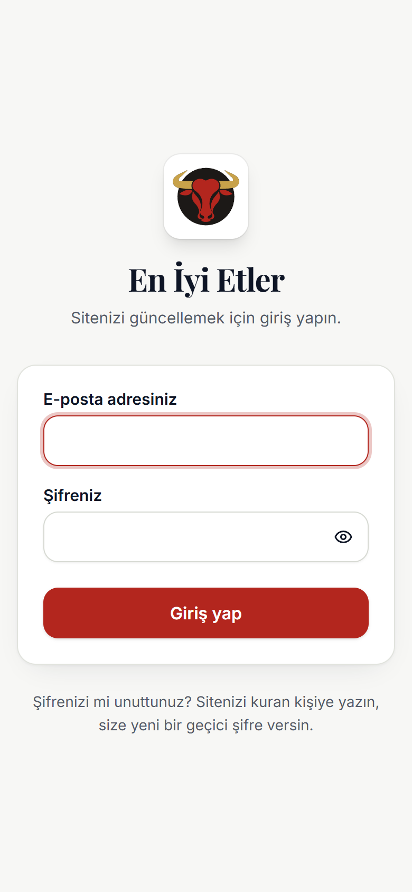
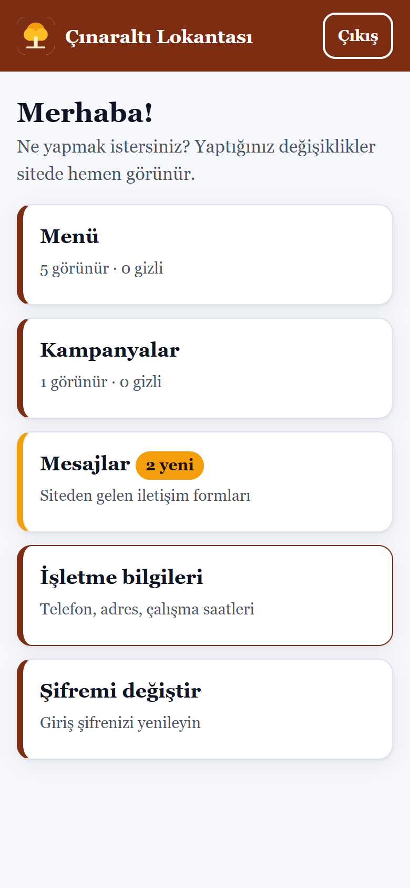
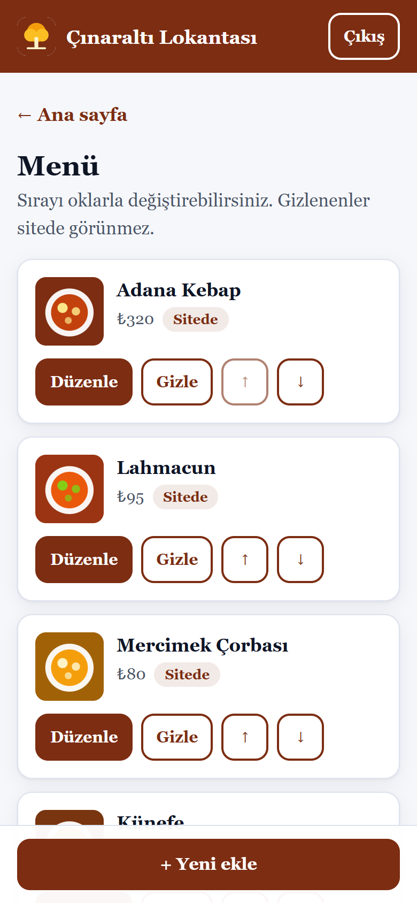
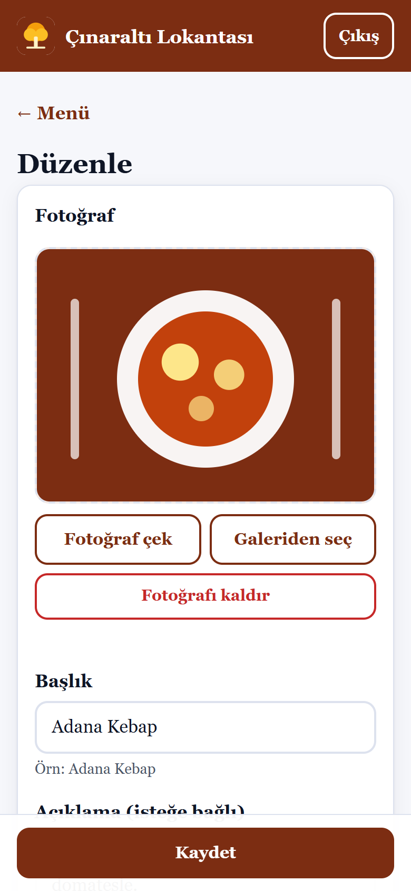
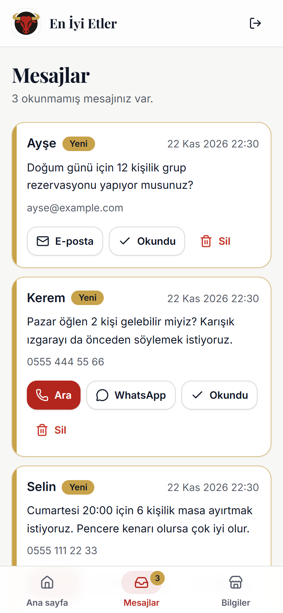
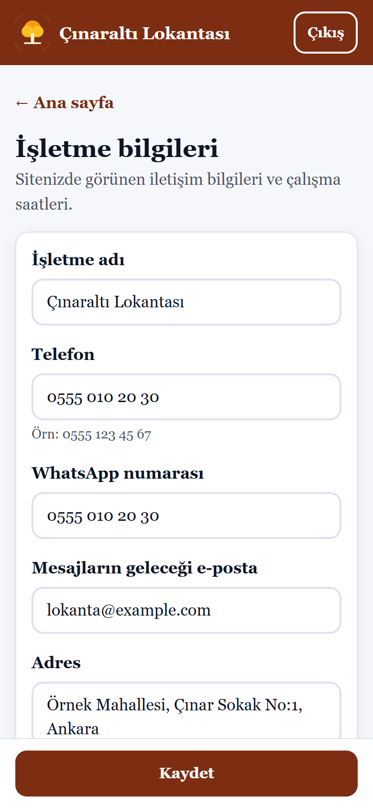
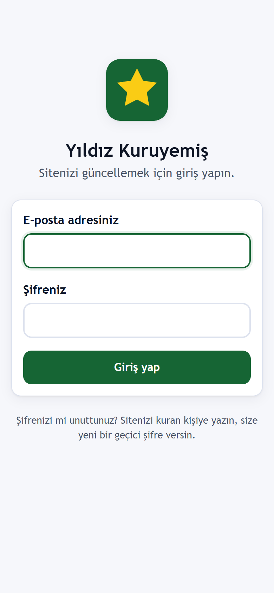
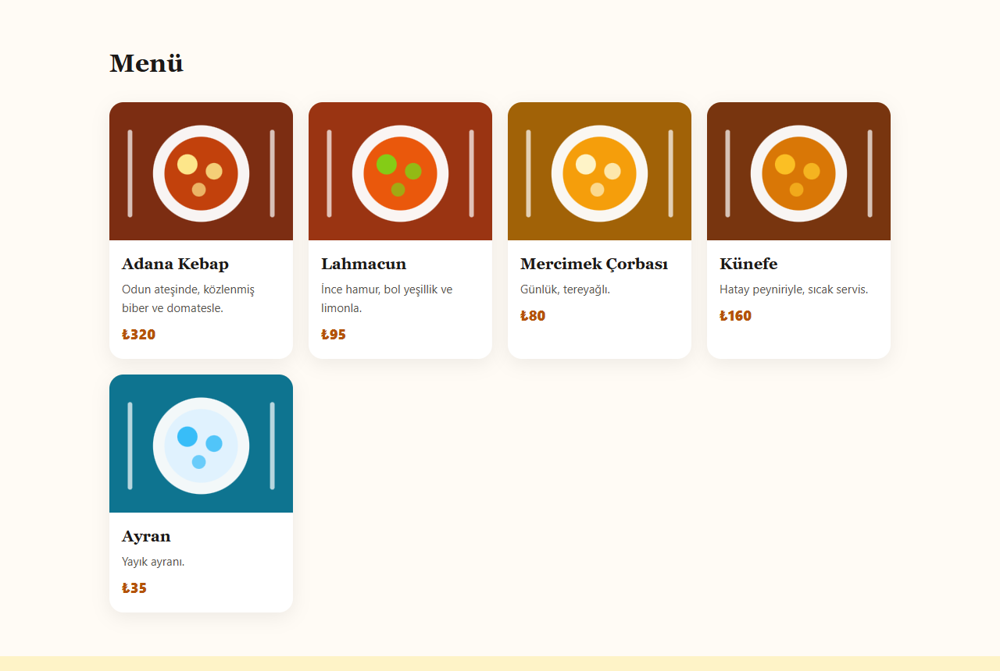

<p align="center">
  
</p>

<p align="center">
  <strong>Statik landing sayfalarını, esnafın telefondan güncelleyebildiği dinamik sitelere çeviren açık kaynak backend.</strong><br />
  Express + SQLite · tek sunucu, çok müşteri · bağımlılıksız ~5 KB snippet · siteye özel mobil yönetim paneli
</p>

<p align="center">
  <a href="https://github.com/poyrazavsever/landing-kit/actions/workflows/ci.yml"></a>
  <a href="LICENSE"></a>
  
  
</p>

<p align="center"><a href="#türkçe">Türkçe</a> · <a href="#english">English</a></p>

---

## Türkçe

### Ne işe yarar?

Claude'a (ya da herhangi birine) bir restoran, berber veya dükkân için güzel bir landing sayfası yazdırmak artık kolay. Zor olan, o sayfanın **yaşaması**: fiyat değişince, kampanya bitince, çalışma saati değişince esnafın sizi araması; iletişim formunun bir yere gitmemesi.

**landing-kit** bu boşluğu kapatır:

- Herhangi bir statik HTML sayfasına **birkaç `data-lk-*` özelliği ve tek satır `<script>`** eklersiniz.
- Menü, hizmetler, ürünler, kampanyalar, telefon, WhatsApp, adres ve çalışma saatleri artık sunucudan gelir.
- İşletme sahibi bunları **telefonundan**, kendi logosu ve renkleriyle açılan bir panelden günceller.
- İletişim formu çalışır: mesaj panele düşer, isterseniz e-posta ve Telegram bildirimi gelir; KVKK onayı sunucu tarafında zorunludur.
- **Tek sunucu, çok müşteri:** freelancer bütün müşterilerini aynı VPS'teki tek kurulumda tutar. Yedek = tek bir SQLite dosyası + `uploads/` klasörünü kopyalamak.

```
 müşterinin alan adı (statik HTML)        sizin VPS'iniz (landing-kit)            esnafın telefonu
┌─────────────────────────────┐   GET    ┌──────────────────────────────┐       ┌──────────────────┐
│ data-lk="phone"             │◄─────────┤ /api/sites/:slug             │◄──────┤ /admin/<slug>    │
│ data-lk-list="menu"         │          │ /api/sites/:slug/items       │       │ menü, fiyat,     │
│ data-lk-form="contact"      ├─────────►│ /api/sites/:slug/contact     │       │ saat, kampanya,  │
│ <script landing-kit.js>     │   POST   │ SQLite + uploads/            │──────►│ mesajlar         │
└─────────────────────────────┘          └──────────────────────────────┘ e-posta└──────────────────┘
                                                                          Telegram
```

### Ekran görüntüleri

| Giriş (müşterinin markası)            | Ana sayfa                                     | Menü                                | Ürün düzenleme                            |
| ------------------------------------- | --------------------------------------------- | ----------------------------------- | ----------------------------------------- |
|  |  |  |  |

| Mesajlar                                    | İşletme bilgileri                           | Başka bir müşterinin paneli                             | Örnek sayfa                                       |
| ------------------------------------------- | ------------------------------------------- | ------------------------------------------------------- | ------------------------------------------------- |
|  |  |  |  |

Örnek müşteri PDF rehberi: [docs/samples/cinaralti-lokanta-admin-rehberi.pdf](docs/samples/cinaralti-lokanta-admin-rehberi.pdf)

### Özellikler

- **Public API:** site bilgisi, aktif ve sıralı koleksiyon kayıtları, iletişim formu.
- **Koleksiyonlar veridir:** `menu`, `services`, `products`, `campaigns`, `gallery`, `faq`… Yeni bir bölüm için kod yazmazsınız.
- **Yönetim paneli:** mobil öncelikli, sade Türkçe; ekle/düzenle/gizle/sırala, kameradan fotoğraf (yüklemeden önce otomatik küçültme), mesaj kutusu (Ara / WhatsApp / E-posta), işletme bilgileri ve 7 günlük çalışma saatleri.
- **Siteye özel panel:** her müşterinin paneli kendi logosu, renkleri ve yazı tipiyle açılır; yazı kontrastı otomatik korunur.
- **Müşteriye PDF rehber:** `npm run guide:pdf` müşterinin markasıyla; panel adresi, kullanıcı adı, QR kod ve destek bilgisiyle A4 PDF üretir.
- **Bildirimler:** SMTP e-posta ve Telegram botu; yeni kanal = `src/notify/` altına bir dosya.
- **Güvenlik:** helmet, site başına CORS izin listesi, form ve girişte hız sınırı, honeypot, bcrypt, `httpOnly` + `SameSite=Strict` (+ production'da `secure`) oturum çerezi, CSRF token, ilk girişte zorunlu şifre değişimi, sunucu tarafı KVKK onayı, girdi doğrulama, sadece parametreli SQL, yüklemede boyut/tür/dosya imzası kontrolü.
- **Bağımlılıksız snippet:** ~5,5 KB (gzip ~2,3 KB). API'ye ulaşılamazsa sayfadaki statik içerik olduğu gibi kalır.
- **Docker + docker-compose**, `/healthz`, Caddy ve systemd örnekleri.
- **Testler:** `node --test` ile public API, form doğrulama/KVKK/honeypot, müşteri izolasyonu, yükleme sınırları ve snippet render (jsdom).

### Hızlı deneme (yerel bilgisayar)

Gereken: Node.js 22 veya üstü.

```bash
git clone https://github.com/poyrazavsever/landing-kit.git
cd landing-kit
npm install
cp .env.example .env            # Windows: copy .env.example .env
npm run seed:demo -- --password demo12345
npm start
```

- Örnek sayfalar: <http://localhost:3000/examples/>
- Panel: <http://localhost:3000/admin/cinaralti-lokanta> (giriş: `lokanta@example.com` / `demo12345`)

> `--password` sadece yerel demo içindir. Parametresiz `npm run seed:demo` rastgele şifreler üretir.

### VPS'te kurulum (hedef: 15 dakika)

Bir Ubuntu/Debian VPS, bir alan adı (ör. `api.ornek.com`) ve sunucuda Docker gerekir ([Docker kurulumu](https://docs.docker.com/engine/install/)).

1. **DNS:** `api.ornek.com` için sunucunun IP'sine bir A kaydı ekleyin.
2. **Kodu alın:**
   ```bash
   git clone https://github.com/poyrazavsever/landing-kit.git /opt/landing-kit
   cd /opt/landing-kit
   cp .env.example .env
   ```
3. **`.env`'i düzenleyin** (en azından bunlar):
   ```ini
   NODE_ENV=production
   PUBLIC_URL=https://api.ornek.com
   # node -e "console.log(require('crypto').randomBytes(32).toString('hex'))"
   SESSION_SECRET=uzun-rastgele-bir-deger
   TRUST_PROXY=1
   SMTP_HOST=...
   SMTP_USER=...
   SMTP_PASS=...
   SMTP_FROM=...
   SUPPORT_NAME=...
   SUPPORT_PHONE=...
   SUPPORT_EMAIL=...
   ```
4. **Başlatın:**
   ```bash
   docker compose up -d
   docker compose ps          # "healthy" görünmeli
   ```
5. **HTTPS (Caddy):** [Caddy'yi kurun](https://caddyserver.com/docs/install), `deploy/Caddyfile` içindeki alan adını değiştirip `/etc/caddy/Caddyfile` olarak kopyalayın, `sudo systemctl reload caddy`. Sertifika otomatik alınır.
6. **Kendi yönetici hesabınız:**
   ```bash
   docker compose exec -u node landing-kit npm run admin:create -- --email ben@ornek.com
   ```
7. **Kontrol:** `curl https://api.ornek.com/healthz` → `{"ok":true}`

> Konteyner içinde komut çalıştırırken `-u node` kullanın; böylece veritabanı dosyaları doğru kullanıcıya ait olur. Veriler sunucuda `./data/` klasöründedir.
> Daha küçük imaj (PDF rehber olmadan): `docker compose build --build-arg WITH_PDF=false`. Bizim denememizde imaj Chromium ile yaklaşık 1,3 GB, Chromium olmadan yaklaşık 400 MB oldu.

#### Docker'sız (Node + systemd + Caddy)

```bash
sudo useradd --system --home /opt/landing-kit landingkit
sudo git clone https://github.com/poyrazavsever/landing-kit.git /opt/landing-kit
cd /opt/landing-kit && sudo npm ci --omit=dev
sudo npx playwright install --with-deps --only-shell chromium   # sadece PDF rehber için
sudo cp .env.example .env && sudo nano .env                     # yukarıdaki ayarlar
sudo chown -R landingkit:landingkit /opt/landing-kit
sudo cp deploy/landing-kit.service /etc/systemd/system/
sudo systemctl enable --now landing-kit
```

Ardından 5. adımdaki Caddy ayarı. PDF için Playwright Chromium yerine kurulu bir Chrome/Edge da kullanılabilir: `.env` içinde `PDF_BROWSER_PATH`.

### Yeni müşteri ekleme

```bash
npm run site:create -- --slug berber-ahmet --name "Berber Ahmet" --email sahibi@ornek.com \
  --domains berberahmet.com --collections services,campaigns \
  --phone "0555 123 45 67" --whatsapp "0555 123 45 67" \
  --primary "#111827" --secondary "#D4A373" --font "Segoe UI" --logo ./berber-logo.png
```

Çıktı: panel adresi, kullanıcı adı, **bir kez gösterilen geçici şifre**, sayfaya eklenecek `<script>` satırı ve `data/guides/berber-ahmet-admin-rehberi.pdf`. İşletme sahibi ilk girişte kendi şifresini belirler.

| Komut                                                   | Ne yapar                                                            |
| ------------------------------------------------------- | ------------------------------------------------------------------- |
| `npm run site:create -- …`                              | Site + sahibinin hesabı + PDF rehber (`--no-guide` ile atlanır)     |
| `npm run site:update -- --slug x --domains a.com,b.com` | Alan adı, bölümler, tema, Telegram chat id gibi teknik ayarlar      |
| `npm run admin:create -- --email ben@ornek.com`         | Bütün siteleri yöneten freelancer hesabı                            |
| `npm run user:reset -- --email sahibi@ornek.com`        | "Şifremi unuttum": yeni geçici şifre verir, açık oturumları kapatır |
| `npm run guide:pdf -- --slug x`                         | Müşterinin markasıyla PDF kullanım rehberi                          |
| `npm run backup`                                        | Tarihli SQLite + uploads yedeği                                     |
| `npm run seed:demo`                                     | Üç hayali demo işletme                                              |

`--domains` CORS izin listesidir: `berberahmet.com` yazmak `https://berberahmet.com` ve `https://www.berberahmet.com` adreslerini kapsar; yerel test için `http://localhost:5500` gibi tam adres yazın. Listede olmayan alan adlarından gelen form gönderimleri reddedilir.

### HTML özellikleri

Snippet'i `</body>`'den önce ekleyin:

```html
<script src="https://api.ornek.com/landing-kit.js" data-site="berber-ahmet" defer></script>
```

```html
<h1 data-lk="name">Berber Ahmet</h1>
<a data-lk="phone" data-lk-href="phone" href="tel:05550000000">0555 000 00 00</a>
<a data-lk-href="whatsapp" href="#">WhatsApp'tan yaz</a>
<ul data-lk="hours">
  <li>Pazartesi–Cumartesi: 09:00–20:00</li>
</ul>

<div data-lk-list="services" data-lk-empty="Yakında">
  <p>Statik yedek içerik (API'ye ulaşılamazsa görünür)</p>
  <template>
    <article>
      
      <h3 data-lk-field="title"></h3>
      <p data-lk-field="description"></p>
      <strong data-lk-field="price"></strong>
    </article>
  </template>
</div>

<form data-lk-form="contact" data-lk-success="Teşekkürler, sizi arayacağız." novalidate>
  <label>Adınız <input name="name" required /></label>
  <label>Telefon <input name="phone" type="tel" /></label>
  <label>Mesajınız <textarea name="message" required></textarea></label>
  <label
    ><input type="checkbox" name="kvkk" value="1" required /> Aydınlatma metnini onaylıyorum</label
  >
  <button type="submit">Gönder</button>
</form>
```

| Özellik                  | Değerler / davranış                                                                                                                                                                                                                                  |
| ------------------------ | ---------------------------------------------------------------------------------------------------------------------------------------------------------------------------------------------------------------------------------------------------- |
| `data-lk`                | `name`, `phone`, `whatsapp`, `email`, `address`, `hours`, `hoursNote`. Metni doldurur; değer boşsa statik metin kalır. `hours` bir `<ul>` ise `<li>` listesi olur, aynı saatli ardışık günler gruplanır.                                             |
| `data-lk-href`           | `phone` → `tel:`, `whatsapp` → `wa.me` (0'la başlayan TR numarası 90'a çevrilir), `email` → `mailto:`, `maps` → Google Haritalar araması.                                                                                                            |
| `data-lk-list`           | Koleksiyon adı. İçindeki `<template>` her kayıt için kopyalanır; template dışındaki içerik veri gelince silinir. `data-lk-limit` ve `data-lk-empty` isteğe bağlı.                                                                                    |
| `data-lk-field`          | `title`, `description`, `price` (₺ ve TR biçimi), `image` (`` ise `src`, değilse arka plan). Boş alanlar gizlenir.                                                                                                                              |
| `data-lk-form="contact"` | Alanlar: `name`, `phone`, `email`, `message`, `kvkk`. Honeypot alanını snippet ekler. Metinler: `data-lk-success`, `data-lk-error`, `data-lk-sending`. Durum için `lk-status` ve `lk-success` / `lk-error` / `lk-sending` sınıflı bir `<p>` eklenir. |
| Durum                    | `<html>` sınıfı `lk-ready` ya da `lk-offline`; olaylar `lk:loaded`, `lk:error`, `lk:list`, `lk:sent`; `window.LandingKit.reload()`.                                                                                                                  |

JavaScript çalışmayan tarayıcılar için formun `action`'ını `https://api.ornek.com/api/sites/<slug>/contact`, `method`'unu `post` yapabilirsiniz; sunucu gönderimden sonra sayfaya `#lk-sent` ile geri yönlendirir.

Hazır Claude prompt'ları: [prompts/claude-landing.md](prompts/claude-landing.md) (restoran, berber, yerel dükkân). Çalışan örnekler: [examples/](examples/).

### Yönetim paneli ve müşteri rehberi

- Panel adresi: `https://api.ornek.com/admin/<slug>`. Freelancer hesabı `/admin/` adresinde bütün siteleri listeler; temayı ve alan adlarını da düzenleyebilir.
- Siteye özel tema: `sites` tablosundaki `logo_path`, `color_primary`, `color_secondary`, `font_family`. Ayrıntı: [docs/style-guide.md](docs/style-guide.md).
- İşletme sahibi için adım adım rehber: [docs/admin-rehberi.md](docs/admin-rehberi.md). PDF rehber bu dosyadan üretilir.

### Bildirimler

- **E-posta:** `.env` içinde `SMTP_*` ayarlıysa mesaj, sitenin "mesajların geleceği e-posta" adresine gider; "yanıtla" ziyaretçinin e-postasına döner.
- **Telegram:** `TELEGRAM_BOT_TOKEN` + site başına `npm run site:update -- --slug x --telegram <chat_id>` (ya da `TELEGRAM_DEFAULT_CHAT_ID`).
- Bildirim gönderilemese bile mesaj veritabanına kaydedilir ve panelde görünür.

### Yedekleme

```bash
npm run backup                                  # data/backups/2026-11-22_0300/
npm run backup -- --out /mnt/yedek --keep 14
```

SQLite'ın çevrimiçi yedekleme API'si kullanıldığı için sunucu çalışırken de güvenlidir. Her gece 03:00'te (Docker, crontab):

```cron
0 3 * * * cd /opt/landing-kit && docker compose exec -T -u node landing-kit npm run backup -- --keep 14
```

Geri yükleme: sunucuyu durdurun, yedekteki `landing-kit.sqlite` dosyasını ve `uploads/` klasörünü `data/` içine kopyalayın, başlatın. Yedekler kişisel veri içerir; güvenli bir yerde saklayın.

### Genişletme noktaları

- **Yeni koleksiyon:** kod gerekmez. Panelden ya da `site:update -- --collections menu,gallery,faq` ile ekleyin, sayfada `data-lk-list="gallery"` kullanın.
- **Yeni bildirim kanalı:** `src/notify/sms.js` gibi bir dosya ekleyin; otomatik yüklenir:
  ```js
  module.exports = {
    name: 'sms',
    isEnabled: (config, site) => Boolean(process.env.SMS_API_KEY && site.phone),
    async send({ config, site, message }) {
      // sağlayıcınızın API'sine istek atın; hata olursa throw edin
    },
  };
  ```
- **Yeni modül (ör. randevu):** `src/routes/booking.js` oluşturup `src/app.js` içinde bağlayın:

  ```js
  // src/routes/booking.js
  const express = require('express');
  const { siteCors } = require('../middleware/site-cors');

  function bookingRoutes({ repos, config }) {
    const router = express.Router();
    router.post('/sites/:slug/bookings', siteCors({ repos, config }), (req, res) => {
      // doğrula, kaydet, bildir
      res.status(201).json({ ok: true });
    });
    return router;
  }

  module.exports = { bookingRoutes };
  // src/app.js içinde: app.use('/api', bookingRoutes({ repos, config }));
  ```

- **Şema değişikliği:** `src/db/migrations/002_bookings.sql` gibi yeni bir dosya ekleyin; açılışta bir kez çalışır. Sorgular düz SQL olduğu için ileride Postgres'e taşımak mümkündür.

### Claude ile çalışmak

- [`prompts/claude-landing.md`](prompts/claude-landing.md): landing-kit özellikleriyle sayfa yazdırma şablonları.
- [`.claude/skills/landing-kit-site`](.claude/skills/landing-kit-site/SKILL.md): statik sayfayı landing-kit'e bağlama, müşteri oluşturma, yayına alma, PDF rehber.
- [`.claude/skills/landing-kit-admin`](.claude/skills/landing-kit-admin/SKILL.md): işletme sahibine paneli adım adım anlatan yardımcı.

Repo Claude Code ile açıldığında bu skill'ler kullanılabilir olur.

### Bu stack ile nasıl iş bulunur?

Bu bölüm bir gelir vaadi değildir; sonuç işe, şehre, müşteriye ve emeğe göre değişir. Sadece bu altyapının nerede işe yaradığını anlatır:

1. **Önce örnek yapın.** Mahallenizde sitesi olmayan ya da sitesi güncel olmayan bir işletme seçin. Gerçek menüsü veya hizmetleriyle bir örnek sayfa hazırlayın ([prompts/](prompts/)), demo panelini açın.
2. **Satılan şey site değil, güncel kalmak.** Esnafın derdi "fiyatımı kim değiştirecek, mesajlar nereye gidecek". Paneli onun telefonunda gösterin; PDF rehberi bırakın.
3. **İzin ve dürüstlük.** İşletmenin adını, logosunu, fotoğraflarını izinle kullanın. Sitede uydurma yorum, sahte indirim ya da doğrulanmamış iddia olmasın.
4. **Bakımı netleştirin.** Alan adı, hosting, yedek, içerik desteği: neyin sizde, neyin işletmede olduğunu baştan yazılı konuşun.
5. **Tek kurulum, çok müşteri.** Her yeni müşteri bir `site:create` komutu; bütün müşteriler aynı sunucuda ve aynı yedekte.
6. **KVKK'yı ciddiye alın.** Aydınlatma metnini işletmeye göre doldurun ([docs/kvkk.md](docs/kvkk.md)); form mesajları kişisel veridir.

### KVKK notu

İletişim formu ad, telefon, e-posta ve mesaj gibi kişisel veriler toplar. landing-kit KVKK onay kutusunu sunucu tarafında zorunlu tutar, honeypot ile spam'i azaltır, verileri sadece kendi sunucunuzdaki SQLite dosyasında saklar ve üçüncü taraf takip kodu içermez. Bunlar **hukuki uyumun tamamı değildir**; veri sorumlusu işletmedir. Aydınlatma metni şablonu: [docs/kvkk.md](docs/kvkk.md) (şablon hukuki danışmanlık değildir).

### Proje yapısı

```
src/
  app.js, server.js, config.js
  db/            migrations/*.sql, migrate.js, repo/ (sites, items, messages, users)
  routes/        public.js, admin.js
  middleware/    site-cors.js, auth.js (oturum, CSRF, müşteri izolasyonu), rate-limit.js
  notify/        email.js, telegram.js (her dosya bir kanal)
  guide/         PDF rehber (şablon + Chromium)
  lib/           doğrulama, yükleme, oturum deposu
public/          landing-kit.js (+ .min.js), admin/ (panel)
scripts/         site-create, site-update, admin-create, user-reset, backup, guide-pdf
examples/        restoran, berber, dükkân + seed.js
prompts/         Claude prompt şablonları
docs/            admin-rehberi, style-guide, kvkk, images/, samples/
brand/           logo dosyaları
deploy/          Caddyfile, systemd unit, docker entrypoint
test/            node:test testleri
```

### Geliştirme

```bash
npm run dev            # dosya değişince yeniden başlar
npm test               # bütün testler
npm run lint           # ESLint
npm run format         # Prettier
npm run build          # public/landing-kit.min.js
```

### Katkı ve lisans

Katkılar memnuniyetle karşılanır: [CONTRIBUTING.md](CONTRIBUTING.md). Değişiklik geçmişi: [CHANGELOG.md](CHANGELOG.md).

MIT Lisansı © 2026 Poyraz Avsever. Ayrıntı: [LICENSE](LICENSE).

---

## English

### What is it?

**landing-kit** is an open-source backend that turns any static landing page into a dynamic site that a small-business owner can update from their phone.

- Add a few `data-lk-*` attributes and one `<script>` tag to any static HTML page.
- Menu, services, products, campaigns, phone, WhatsApp, address and opening hours now come from the server.
- The owner edits them in a mobile-first admin panel that opens with **their own logo, colors and font**.
- The contact form works: messages land in the panel, with optional email (SMTP) and Telegram notifications; KVKK (Turkish data protection) consent is enforced server-side.
- **One server, many customers:** a freelancer hosts all clients in a single install on one VPS. Backup = copy one SQLite file plus `uploads/`.

### Features

- Public API: site info, active and sorted collection items, contact form.
- Collections are data (`menu`, `services`, `products`, `campaigns`, `gallery`, `faq`, …): new sections need no code.
- Admin panel: add/edit/hide/reorder, camera photo upload with client-side resize, inbox with call/WhatsApp/email shortcuts, site info and weekly opening hours. Turkish UI written for non-technical users, 44–48 px tap targets, automatic contrast correction for customer colors.
- Branded customer PDF guide (`npm run guide:pdf`) with panel URL, username, QR code and your support contact. Sample: [docs/samples/cinaralti-lokanta-admin-rehberi.pdf](docs/samples/cinaralti-lokanta-admin-rehberi.pdf).
- Security: helmet, per-site CORS allow-list, rate limiting on form and login, honeypot, bcrypt, `httpOnly` + `SameSite=Strict` (+ `secure` in production) session cookie, CSRF tokens, forced password change on first login, input validation, parameterized SQL only, upload size/type/file-signature checks.
- Dependency-free client snippet, ~5.5 KB minified (~2.3 KB gzip). If the API is unreachable, the static page content stays.
- Docker + docker-compose with `/healthz`, Caddy and systemd examples. Tests with `node --test`.

### Quick start (local)

```bash
git clone https://github.com/poyrazavsever/landing-kit.git && cd landing-kit
npm install
cp .env.example .env
npm run seed:demo -- --password demo12345
npm start
```

Open <http://localhost:3000/examples/> and the panel at <http://localhost:3000/admin/cinaralti-lokanta> (`lokanta@example.com` / `demo12345`). Node.js 22+ is required.

### Deploy on a VPS (target: 15 minutes)

1. Point a DNS A record (e.g. `api.example.com`) to your server and install Docker.
2. `git clone https://github.com/poyrazavsever/landing-kit.git /opt/landing-kit && cd /opt/landing-kit && cp .env.example .env`
3. Edit `.env`: `NODE_ENV=production`, `PUBLIC_URL=https://api.example.com`, a random 32+ character `SESSION_SECRET`, `TRUST_PROXY=1`, SMTP and support contact.
4. `docker compose up -d`, then check that `docker compose ps` shows `healthy`.
5. Install Caddy, copy `deploy/Caddyfile` (with your domain) to `/etc/caddy/Caddyfile` and reload. HTTPS is automatic.
6. Create your freelancer account: `docker compose exec -u node landing-kit npm run admin:create -- --email you@example.com`.

For a smaller image without the PDF generator (about 400 MB instead of about 1.3 GB in our build): `docker compose build --build-arg WITH_PDF=false`.

Without Docker: `npm ci --omit=dev`, `npx playwright install --with-deps --only-shell chromium` (PDF only), `deploy/landing-kit.service` for systemd, then Caddy as above. `PDF_BROWSER_PATH` can point to an installed Chrome/Edge instead.

### Add a customer

```bash
npm run site:create -- --slug barber-joe --name "Barber Joe" --email owner@example.com \
  --domains barberjoe.com --collections services,campaigns --primary "#111827" --logo ./logo.png
```

Prints the panel URL, username, a one-time password and the `<script>` line, and writes the branded PDF guide to `data/guides/`. Other commands: `site:update`, `admin:create`, `user:reset` (forgotten password), `guide:pdf`, `backup`, `seed:demo` (see the table in the Turkish section).

### HTML attributes

| Attribute                | Behaviour                                                                                                                                           |
| ------------------------ | --------------------------------------------------------------------------------------------------------------------------------------------------- |
| `data-lk`                | `name`, `phone`, `whatsapp`, `email`, `address`, `hours`, `hoursNote`: fills text, keeps the static text when empty.                                |
| `data-lk-href`           | `phone` (tel:), `whatsapp` (wa.me), `email` (mailto:), `maps` (Google Maps search).                                                                 |
| `data-lk-list`           | Collection key; its `<template>` is cloned per item. Optional `data-lk-limit`, `data-lk-empty`.                                                     |
| `data-lk-field`          | `title`, `description`, `price` (TRY, Turkish format), `image`. Empty fields are hidden.                                                            |
| `data-lk-form="contact"` | Fields `name`, `phone`, `email`, `message`, `kvkk`. A honeypot is injected. Custom texts via `data-lk-success`, `data-lk-error`, `data-lk-sending`. |
| State                    | `<html>` gets `lk-ready` or `lk-offline`; events `lk:loaded`, `lk:error`, `lk:list`, `lk:sent`; `window.LandingKit.reload()`.                       |

The full example is in the Turkish section; ready-made Claude prompts are in [prompts/claude-landing.md](prompts/claude-landing.md) and working demos in [examples/](examples/).

### Backup

`npm run backup` is safe while the server runs (SQLite online backup API). Options: `--out <dir>`, `--keep <n>`. A crontab example is in the Turkish section.

### Extension points

- **New collection:** data only (`site:update -- --collections menu,gallery`), then `data-lk-list="gallery"`.
- **New notification channel:** drop a file into `src/notify/` exporting `{ name, isEnabled(config, site), async send({ config, site, message }) }`.
- **New module:** e.g. `src/routes/booking.js`, mounted in `src/app.js` (example in the Turkish section).
- **Schema changes:** add `src/db/migrations/00X_*.sql`; plain SQL keeps a future Postgres move possible.

### Claude skills

`.claude/skills/landing-kit-site` (wire a static page, create customers, deploy, PDF guide) and `.claude/skills/landing-kit-admin` (walk a business owner through the panel in Turkish).

### Finding work with this stack

No income promises: results depend on your market, clients and effort. What this stack is good for: build a real sample page for a local business first, show the owner the panel on their own phone, use names/logos/photos only with permission, agree in writing on hosting, domain, backups and support, and treat contact form data as personal data.

### KVKK / privacy

The form enforces consent server-side, filters bots with a honeypot, stores data only in your own SQLite file and ships no third-party trackers. That alone is not full legal compliance; the business is the data controller. [docs/kvkk.md](docs/kvkk.md) is a template, not legal advice.

### Contributing and license

See [CONTRIBUTING.md](CONTRIBUTING.md) and [CHANGELOG.md](CHANGELOG.md). MIT License © 2026 Poyraz Avsever.
