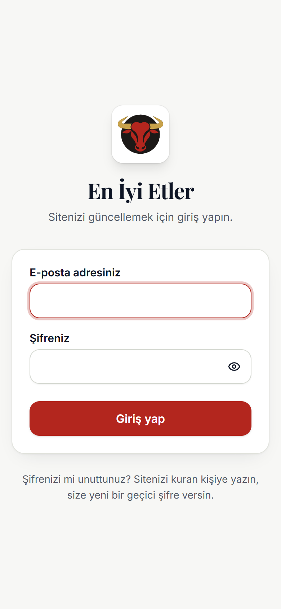
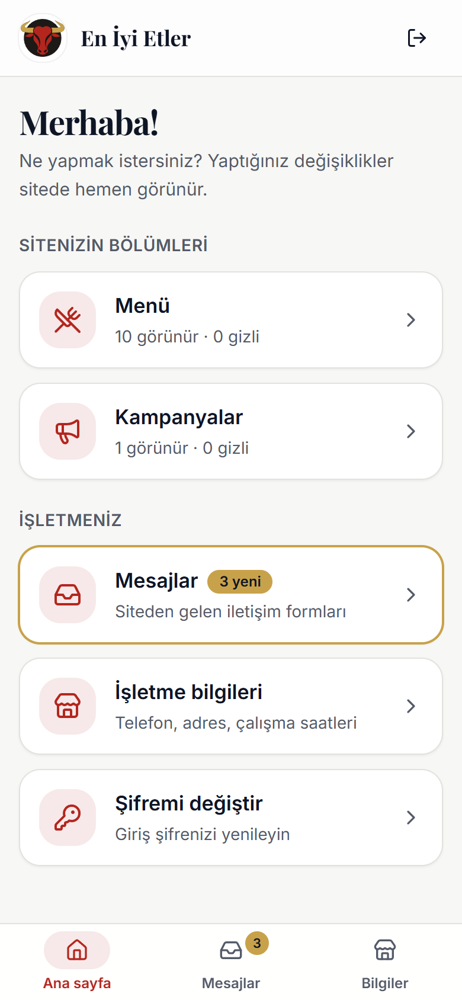
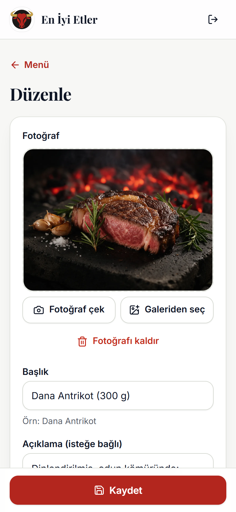
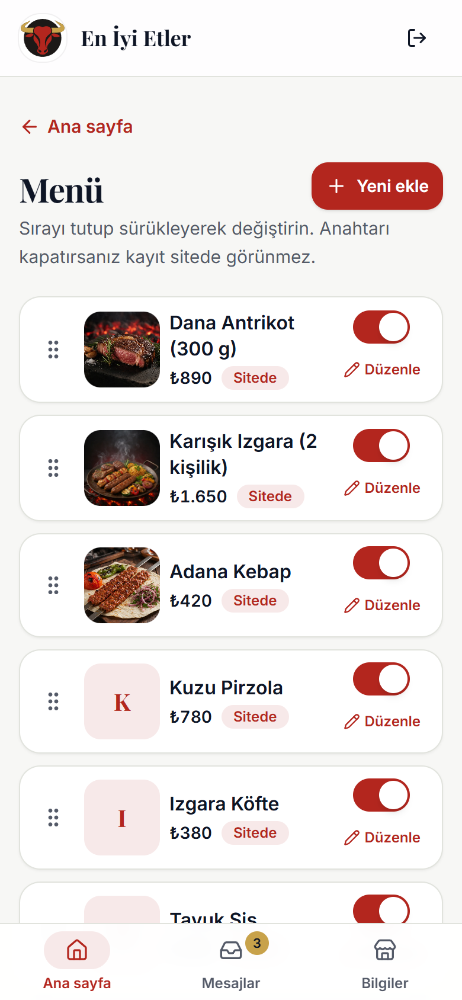
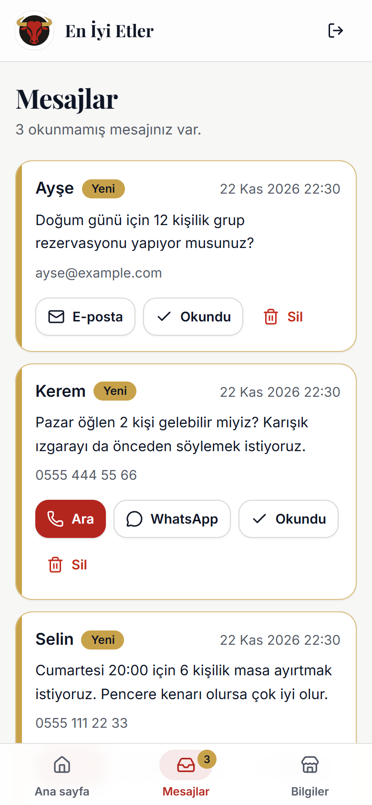
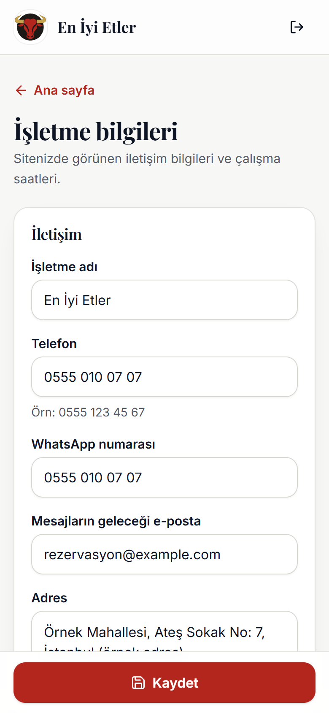

# Yönetim Paneli Rehberi

Bu rehber, işletmenizin sitesini **telefonunuzdan** güncellemeniz için hazırlandı. Teknik bilgi gerekmez. Yaptığınız her değişiklik sitede **hemen** görünür; kimseyi aramanıza ya da beklemenize gerek yok.

> Panel adresinizi ve kullanıcı adınızı sitenizi kuran kişi size verir. Panel sizin logonuz, renkleriniz ve adınızla açılır. Adresi telefonunuzun ana ekranına eklerseniz bir uygulama gibi tek dokunuşla açılır (aşağıda "İpuçları" bölümüne bakın).

## 1. Panele giriş

1. Telefonunuzdan panel adresinizi açın. Ekranda kendi logonuzu ve işletme adınızı görürsünüz.
2. **E-posta adresiniz** kutusuna size verilen e-postayı yazın.
3. **Şifreniz** kutusuna şifrenizi yazın. Yazdığınızı görmek isterseniz kutunun sağındaki göz simgesine dokunun.
4. **Giriş yap** düğmesine dokunun.

Giriş yaptıktan sonra telefonunuz sizi hatırlar. Her seferinde şifre yazmanız gerekmez. Ortak kullanılan bir cihazdaysanız işiniz bitince sağ üstteki çıkış simgesine dokunun.

## 2. İlk girişte kendi şifrenizi belirleyin

İlk girişte size **geçici bir şifre** verilir. Panel sizden hemen yeni bir şifre ister:

1. **Size verilen geçici şifre** kutusuna geçici şifreyi yazın.
2. **Yeni şifreniz** kutusuna en az 8 karakterlik kendi şifrenizi yazın.
3. **Şifremi kaydet** düğmesine dokunun.

Şifrenizi kimseyle paylaşmayın. Sitenizi kuran kişi de şifrenizi göremez.

## 3. Ana sayfa ve alt menü

Girişten sonra ana sayfayı görürsünüz. **Sitenizin bölümleri** başlığı altındaki kutular sitenizin bölümleridir: örneğin **Menü**, **Hizmetler**, **Ürünler** ya da **Kampanyalar**. Her kutuda kaç kaydın sitede göründüğü ve kaçının gizli olduğu yazar.

Ekranın altındaki menüden üç yere tek dokunuşla geçersiniz:

- **Ana sayfa**: bölümleriniz.
- **Mesajlar**: sitenizdeki formdan gelen mesajlar. Yeni mesaj varsa simgenin üstünde bir sayı görünür.
- **Bilgiler**: telefon, WhatsApp, adres ve çalışma saatleri.

## 4. Fotoğraflı yeni bir ürün ekleyin

Örnek: menünüze yeni bir yemek ekleyelim.

1. Ana sayfada **Menü** kutusuna dokunun.
2. Sağ üstteki **Yeni ekle** düğmesine dokunun (bölüm boşsa ortadaki **İlk kaydı ekle** düğmesine).
3. **Fotoğraf çek** düğmesine dokunun ve ürünün fotoğrafını çekin. Telefonunuzda hazır bir fotoğraf varsa **Galeriden seç** düğmesini kullanın.
4. Fotoğraf yüklenince önizlemesini görürsünüz; ekranın üstünde "Fotoğraf yüklendi" yazar.
5. **Başlık** kutusuna ürünün adını yazın (örneğin "Dana Antrikot").
6. İsterseniz **Açıklama** yazın (örneğin "Közlenmiş sebze ile").
7. **Fiyat** kutusuna sadece rakamı yazın: `150` ya da `149,90`. "TL" yazmanıza gerek yok.
8. **Sitede göster** anahtarının açık (renkli) olduğundan emin olun.
9. Ekranın altındaki **Ekle** düğmesine dokunun.

Ürün artık sitenizde. Sayfayı yenileyen herkes görür.

**Fotoğraf ipuçları:** Gün ışığında, sade bir zeminde, ürünü yakından çekin. Telefonu yatay tutmak çoğu sitede daha iyi görünür. Büyük fotoğraflar panel tarafından otomatik küçültülür, sizin bir şey yapmanız gerekmez.

## 5. Bir ürünü gizleyin (silmeden)

Bir ürün bitti ya da mevsimi geçti mi? Silmenize gerek yok, **gizleyin**. Sonra tek dokunuşla geri açarsınız.

1. İlgili bölüme girin (örneğin **Menü**).
2. Ürünün sağındaki **anahtara** dokunun. Anahtar kapanır (gri olur), ürünün yanında **Gizli** yazar ve sitede görünmez.
3. Tekrar göstermek için anahtara yeniden dokunun; **Sitede** yazar.

## 6. Fiyat değiştirin

1. İlgili bölüme girin.
2. Ürünün adına ya da sağındaki **Düzenle** yazısına dokunun.
3. **Fiyat** kutusundaki rakamı silip yenisini yazın.
4. Ekranın altındaki **Kaydet** düğmesine dokunun.

Fiyatı olmayan bir şey (örneğin "Günün çorbası sorunuz") için fiyat kutusunu boş bırakın; sitede fiyat yerine hiçbir şey görünmez.

## 7. Sırayı değiştirin

Listede her ürünün solunda altı noktalı bir **tutamaç** (⋮⋮) vardır. Parmağınızı tutamacın üstüne koyun, yarım saniye bekleyin ve ürünü yukarı ya da aşağı sürükleyip bırakın. Ekranın üstünde "Sıralama kaydedildi" yazar; sitede de aynı sırayla görünür. En çok satan ürünlerinizi en üste koymanızı öneririz.

Klavyeyle kullanıyorsanız: tutamaca gelin, boşluk tuşuna basın, ok tuşlarıyla taşıyın, yeniden boşluk tuşuyla bırakın.

## 8. Kampanya ekleyin ve bitirin

1. Ana sayfada **Kampanyalar** kutusuna dokunun.
2. **Yeni ekle** düğmesine dokunun.
3. **Başlık** kutusuna kampanyayı kısa ve net yazın (örneğin "Hafta içi öğle menüsü 449 TL").
4. Ayrıntıyı **Açıklama** kutusuna yazın (saatler, koşullar).
5. **Ekle** düğmesine dokunun.

Kampanya bittiğinde silmek yerine anahtarı kapatıp **gizleyin**. Gelecek yıl aynı kampanyayı tek dokunuşla geri açabilirsiniz.

## 9. Bir kaydı silin

1. Kaydı açın (adına dokunun).
2. Formun altındaki **Bu kaydı sil** yazısına dokunun.
3. Açılan pencerede uyarıyı okuyun ve **Evet, sil** düğmesine dokunun. Vazgeçtiyseniz **Vazgeç**.

Silinen kayıt geri gelmez. Emin değilseniz silmek yerine gizleyin.

## 10. Gelen mesajları okuyun

Sitenizdeki formu dolduran müşterilerin mesajları buraya gelir. Sitenizi kuran kişi ayarladıysa her yeni mesaj e-postanıza ya da Telegram'a da bildirim olarak düşer.

1. Alt menüden **Mesajlar**'a dokunun.
2. Yeni mesajların yanında **Yeni** etiketi ve solunda renkli bir şerit vardır.
3. Müşteriyi hemen aramak için **Ara**, WhatsApp'tan yazmak için **WhatsApp**, e-posta bıraktıysa **E-posta** düğmesine dokunun.
4. Mesajla ilgilendikten sonra **Okundu** düğmesine dokunun.
5. Artık gerekmeyen mesajları **Sil** ile silebilirsiniz; panel önce onay ister.

**Önemli (KVKK):** Mesajlar müşterilerinizin kişisel bilgilerini içerir. Bu bilgileri sadece müşteriye dönüş yapmak için kullanın, başkalarıyla paylaşmayın ve işiniz bittiğinde silin.

## 11. Telefon, adres ve çalışma saatlerini değiştirin

1. Alt menüden **Bilgiler**'e dokunun.
2. Değiştirmek istediğiniz kutuya dokunup yeni bilgiyi yazın: **Telefon**, **WhatsApp numarası**, **Mesajların geleceği e-posta**, **Adres**.
3. **Çalışma saatleri** bölümünde her gün için açılış ve kapanış saatini seçin. O gün kapalıysanız günün yanındaki anahtarı kapatın; **Kapalı** yazar.
4. Bayram ya da tatil gibi geçici durumlar için **Not** kutusuna yazın (örneğin "Bayramın ilk günü kapalıyız").
5. Ekranın altındaki **Kaydet** düğmesine dokunun.

## 12. Şifrenizi değiştirin

1. Ana sayfada **Şifremi değiştir** kutusuna dokunun.
2. Şu anki şifrenizi ve yeni şifrenizi yazın.
3. **Şifremi kaydet** düğmesine dokunun.

## 13. Şifrenizi unuttuysanız

Güvenlik nedeniyle panelde "şifremi unuttum" bağlantısı yoktur. Şifrenizi unuttuysanız:

1. Sitenizi kuran kişiyi (destek iletişim bilgileri bu rehberin başında) arayın ya da yazın.
2. Size yeni bir **geçici şifre** verir.
3. Geçici şifreyle giriş yapın; panel sizden hemen yeni bir şifre belirlemenizi ister (bkz. 2. adım).

Geçici şifre verildiğinde açık olan bütün oturumlarınız kapanır, yani şifrenizi bilen başka biri de içeride kalamaz.

## İpuçları

- **Ana ekrana ekleyin:** Panel adresini telefonunuzun tarayıcısında açın. iPhone'da paylaş düğmesi → **Ana Ekrana Ekle**; Android'de menü (⋮) → **Ana ekrana ekle**. Panel artık bir uygulama gibi açılır.
- **Değişiklik sitede görünmüyorsa:** Sitenizi açtığınız sekmeyi yenileyin. Hâlâ görünmüyorsa ürünün **Gizli** olmadığından emin olun.
- **Hata mesajı alırsanız:** Ekranın üstünde kırmızı bir uyarı çıkar ve ne yapmanız gerektiğini yazar; hatalı kutunun altında da kırmızı bir açıklama görünür. İnternet bağlantınızı kontrol edip tekrar deneyin.
- **Bir şey yüklenmezse:** Ekranda **Tekrar dene** düğmesi çıkar; ona dokunun.

## Sık sorulanlar

**Değişikliklerim ne zaman sitede görünür?**
Hemen. Kaydet düğmesine dokunduğunuz anda sitede güncellenir.

**Telefonum yerine bilgisayardan da girebilir miyim?**
Evet. Aynı adres bilgisayarda da çalışır.

**Sitenin tasarımını, renklerini ya da yazılarını değiştirebilir miyim?**
Paneldeki bilgiler (menü, fiyatlar, kampanyalar, iletişim bilgileri, saatler) sizindir. Tasarım, renkler ve sayfadaki sabit yazılar için sitenizi kuran kişiye ulaşın.

**Yeni bir bölüm (örneğin "Galeri" ya da "Sık Sorulanlar") istiyorum.**
Sitenizi kuran kişiye söyleyin; yeni bir bölüm eklemek kısa bir iştir.
